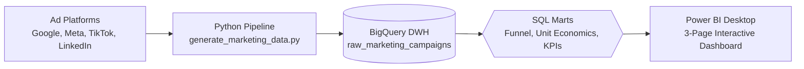
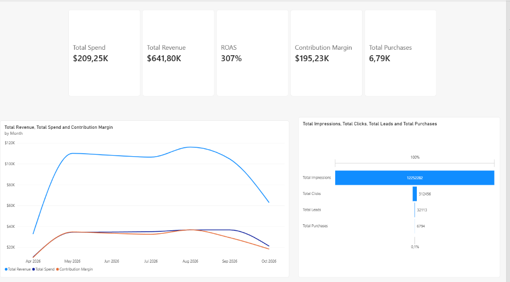
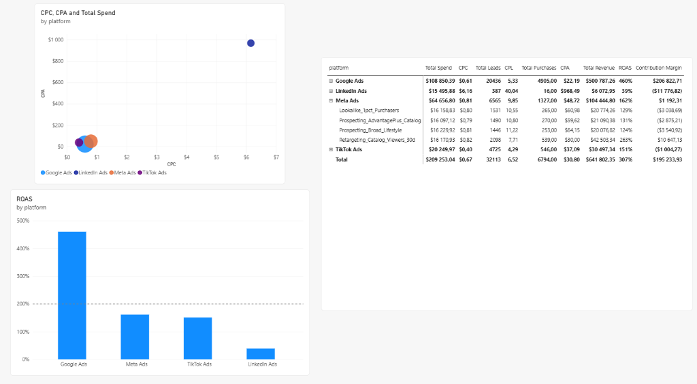
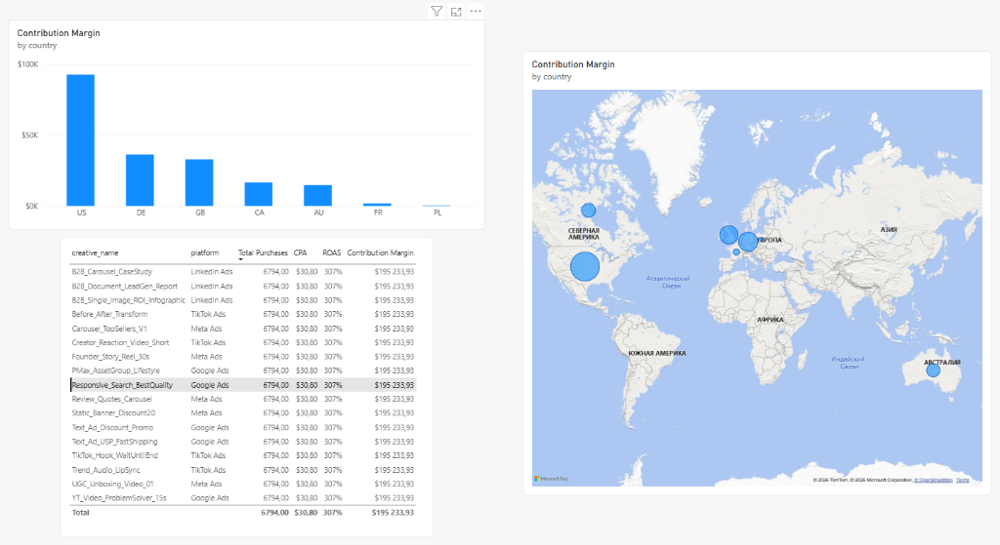

# 📊 Marketing Analytics & Unit Economics DWH

> End-to-end Marketing Analytics Data Warehouse and 3-page Power BI Executive Dashboard.  
> **Stack:** Python (ETL) $\to$ Google BigQuery (DWH & SQL Marts) $\to$ Microsoft Power BI (DAX).

---

## 🏗 Architecture



---

## 🖥 Dashboard Preview

### Page 1: Executive Summary

* High-level KPI cards: **$209.3K** Spend, **$641.8K** Revenue, **307%** Blended ROAS, **$195.2K** Contribution Margin, **6.8K** Purchases.
* 180-day trend lines (Revenue, Spend, Contribution Margin) and end-to-end conversion funnel.

### Page 2: Channel Performance

* Channel efficiency matrix (Scatter Plot: CPC vs CPA, sized by Spend).
* ROAS by platform benchmarked against a 200% target line.
* Drill-down campaign performance matrix.

### Page 3: Unit Economics & Creatives

* Contribution Margin by country and interactive geographic map (US and DE driving 62%+ of profits).
* Granular creative performance and profitability classification.

---

## 💡 Key Business Findings

* **Google Ads — Core Profit Driver:** Highest ROAS (**460%**) and **+$206.8K** Contribution Margin. High-intent search and PMax convert at 24% lead-to-order.
* **Meta Ads — Scale at Near Break-Even:** Generated 1,327 purchases at **162%** ROAS, facing ad fatigue on static banners after 45 days.
* **TikTok Ads — The Low CPA Paradox:** Cheapest customer acquisition (**$37.09** vs Meta's $48.72), but lower ROAS (**151%**) due to low Average Order Value ($55.86 vs $78.71).
* **LinkedIn Ads — Value-Destructive Experiment:** High B2B CPC ($6.16) and $968 CPA yielded **39%** ROAS and **-$11.8K** loss. Pausing this campaign preserves $15K+/quarter.

---

## 📐 Data Warehouse Structure

| Layer | Object | Description |
| :--- | :--- | :--- |
| **Raw** | `raw_marketing_campaigns` | 13,218 rows across 180 days, 4 ad platforms, 7 countries. Clustered by `platform, country, campaign_id`. |
| **Mart** | `mart_marketing_funnel` | Aggregated funnel metrics: CTR, CPC, CPL, CPA, CR1, CR2, ROAS, Contribution Margin. |
| **Mart** | `mart_unit_economics_geo_creative` | Granular combinations with unit margin per order (`cm_per_order`) and profitability status. |
| **Mart** | `mart_executive_kpis` | Executive daily time-series with 7-day rolling moving averages. |

---

## 🚀 Quickstart

### 1. Requirements
* Python 3.10+
* Google Cloud Platform service account key (`credentials.json`) in root.

### 2. Run Pipeline
```bash
# Install dependencies
pip install pandas numpy google-cloud-bigquery pyarrow openpyxl

# Generate dataset and ingest to BigQuery
python generate_marketing_data.py

# Deploy analytical SQL views in BigQuery
python apply_sql_views.py
```

### 3. Open Dashboard
* Open `marketing.pbix` in **Power BI Desktop**.
* Data connects directly to BigQuery dataset `martech_dwh` (or offline fallback `data/raw_marketing_campaigns.xlsx`).

---

## 💼 Resume Highlights

* *«Architected an end-to-end Marketing Analytics & Unit Economics DWH on Google BigQuery and Power BI across 4 major ad channels (Google, Meta, TikTok, LinkedIn) managing $200k+ ad spend.»*
* *«Engineered analytical SQL marts and automated data pipelines modeling multi-touch funnel conversion stages (CTR, CPC, CPL, CPA, CR1, CR2) and unit economics (Contribution Margin, ROAS, Net ROI).»*
* *«Uncovered negative-margin creative fatigue and channel discrepancies (e.g. TikTok low CPA vs low AOV paradox), producing data-backed budget reallocations projected to prevent 15% wasted ad spend.»*
